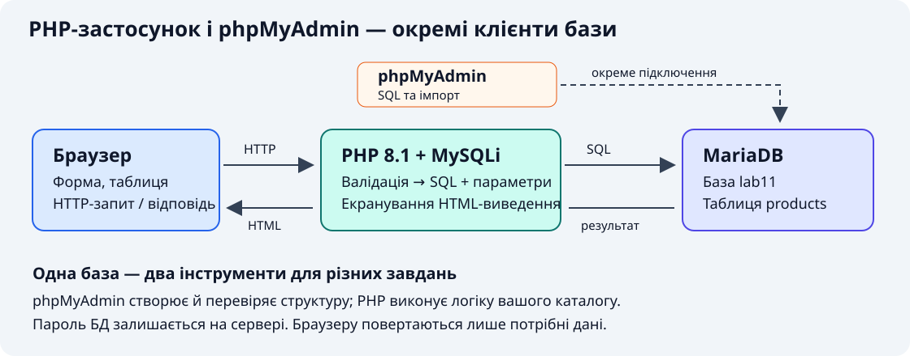
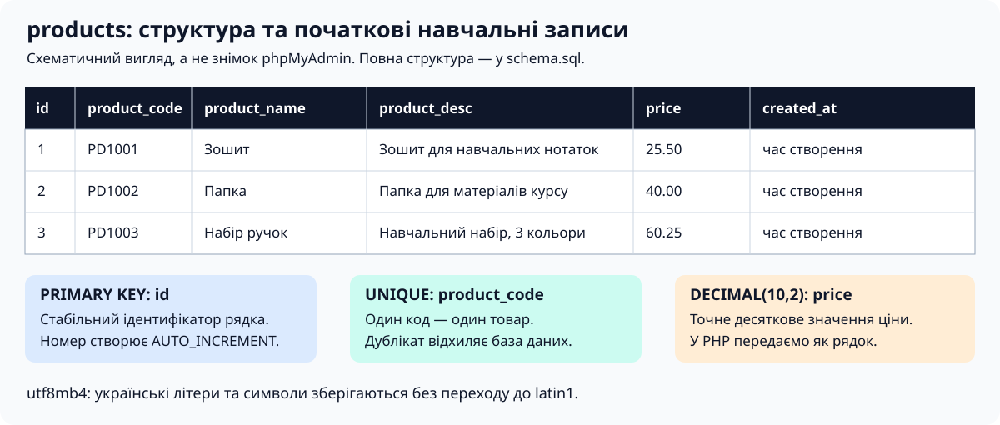
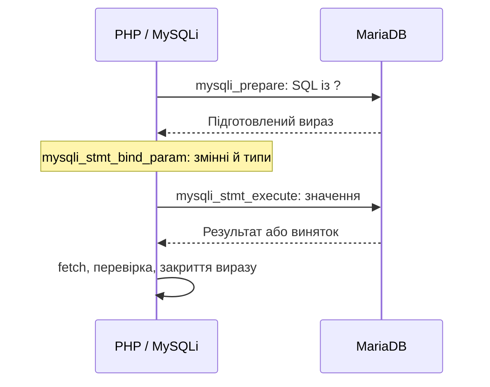
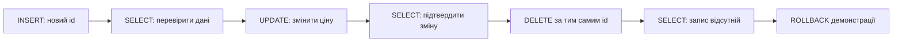

# Лабораторна робота №11. Робота з СКБД MySQL та оболонкою phpMyAdmin

[Перелік усіх робіт](../README.md)

## Тема та мета роботи

**Тема:** класичні засоби роботи з MySQL: SQL, phpMyAdmin і процедурний інтерфейс MySQLi у PHP.

Навчитися створювати таблицю, виконувати SELECT, INSERT, UPDATE, DELETE, отримувати результати запитів і переносити каталог із XML/JSON до реляційної бази. Закріпити перевірку введення, параметризовані запити та безпечне відображення даних.

## Обладнання та передумови

Основне середовище — **OSPanel 6+ із PHP 8.1**, альтернатива — **XAMPP із PHP 8.1**. Потрібні запущена MariaDB, доступ до phpMyAdmin, розширення `mysqli` і `mbstring`, редактор коду та браузер. Налаштування каталогів і консолі — у [пам’ятці середовища](../../ENVIRONMENT.md).

У курсі використовуємо MariaDB як сервер із сумісним протоколом MySQL. Назва MySQLi позначає розширення PHP для доступу до такого сервера. Усі серверні приклади цієї роботи — чистий PHP з функціями `mysqli_*`; класи власної моделі та фреймворки не потрібні. Старі функції `mysql_*` у PHP 8.1 не використовують.

Повторіть [лекцію 8](../../Лекціі/lec-08/README.md), [форми з ЛР 5](../lab-05/README.md), [захист стану й форм із ЛР 7](../lab-07/README.md) та [каталог за варіантом із ЛР 8](../lab-08/README.md). Версію сервера, хост, порт та облікові дані визначте у власному середовищі; не припускайте автоматично порт 3306 або порожній пароль.

## Теоретичні відомості

### Хто виконує запит

phpMyAdmin — вебінтерфейс адміністрування: створення структури, виконання SQL, імпорт та експорт. Він не зберігає дані замість MariaDB й не потрібен як посередник між вашим PHP-кодом і сервером БД.



Обидва інтерфейси MySQLi — процедурний та об’єктний — підтримуються. У цій роботі послідовно використовуємо процедурний: `mysqli_query($db, $sql)`, `mysqli_prepare($db, $sql)`, `mysqli_close($db)`. Процедурний стиль не є застарілим або небезпечним сам по собі; безпека залежить від організації роботи з даними.

### Таблиця, ключі та ціна

Навчальна таблиця `products` містить товар, його унікальний код, опис, ціну й час створення. `PRIMARY KEY` визначає рядок за id; `UNIQUE` не дозволяє двом товарам мати той самий код. Українські рядки зберігаємо в `utf8mb4`.



Ціна має тип `DECIMAL(10,2)`: десять цифр загалом, дві після крапки. У PHP передаємо її як перевірений десятковий **рядок** через тип `s` у bind_param, щоб уникнути похибок float. Приклад приймає 0–99999999.99; вимога невід’ємності перевіряється застосунком. Час `created_at` встановлює сервер БД; часовий пояс сеансу БД слід враховувати окремо від налаштування часу PHP.

### Види SQL та результати MySQLi

| Операція | Призначення | Як перевірити результат |
| --- | --- | --- |
| CREATE TABLE | Визначити структуру | Structure у phpMyAdmin, SHOW CREATE TABLE |
| SELECT | Прочитати рядки | Набір результатів, fetch-функції, порожній список |
| INSERT | Додати запис | Успішне execute, insert_id, повторний SELECT |
| UPDATE | Змінити запис | affected_rows і повторний SELECT |
| DELETE | Видалити запис | affected_rows і відсутність рядка після SELECT |

Підготовлений запит відокремлює SQL від значень. Маркер `?` задає значення, а не назву таблиці чи стовпця. Типи bind_param: `i` — ціле, `d` — число з рухомою крапкою, `s` — рядок, `b` — бінарні дані. Для назв полів сортування потрібен фіксований перелік у коді.



Заміна введення на HTML-сутності не захищає SQL. Параметризація захищає структуру запиту; перевірка типів і меж забезпечує правильні дані; `htmlspecialchars()` захищає HTML-виведення. Ці дії не замінюють одна одну.

## Хід роботи

### 1. Підготуйте середовище й базу

1. Запустіть вебсервер проєкту та модуль MariaDB в OSPanel. Для альтернативного XAMPP запустіть Apache й сервер БД.
2. Відкрийте phpMyAdmin через меню середовища. Адреса залежить від інсталяції; `http://localhost/phpmyadmin/` — лише типовий варіант XAMPP.
3. Створіть **власну навчальну базу** `lab11` із кодуванням utf8mb4. Не видаляйте існуючі бази або таблиці інших проєктів. Якщо ім’я зайняте, оберіть інше й узгодьте DB_NAME.
4. Підготуйте користувача застосунку з правами SELECT, INSERT, UPDATE, DELETE на цю базу. Створення структури виконуйте обліковим записом із відповідними правами адміністратора. Не записуйте його пароль у PHP-файли чи звіт.
5. У публічному каталозі проєкту створіть `lab-11` та скопіюйте туди [src](src). Для XAMPP типовий шлях — `C:\xampp\htdocs\lab-11`. Інші проєкти не видаляйте.

У phpMyAdmin виберіть базу **перед** виконанням SQL. Усі подальші операції стосуються саме її.

### 2. Створіть таблицю та перевірте початкові дані

Перейдіть на вкладку **SQL**, вставте [schema.sql](src/schema.sql) та виконайте його. Альтернатива — вкладка **Import / Імпорт**, вибір цього файла та виконання імпорту. Скрипт призначений для одного запуску в порожній навчальній базі; він не очищує наявну таблицю.

```sql
CREATE TABLE products (
    id INT UNSIGNED NOT NULL AUTO_INCREMENT,
    product_code VARCHAR(20) NOT NULL,
    product_name VARCHAR(80) NOT NULL,
    product_desc VARCHAR(500) NOT NULL,
    price DECIMAL(10,2) NOT NULL,
    created_at TIMESTAMP NOT NULL DEFAULT CURRENT_TIMESTAMP,
    PRIMARY KEY (id),
    UNIQUE KEY uq_products_code (product_code)
) ENGINE=InnoDB DEFAULT CHARSET=utf8mb4 COLLATE=utf8mb4_unicode_ci;
```

Після імпорту відкрийте **Structure / Структура**: перевірте типи й ключі. У **Browse / Огляд** мають бути три товари: Зошит — 25.50, Папка — 40.00, Набір ручок — 60.25. Вкладки можуть мати локалізовані назви.

У SQL виконайте:

```sql
SELECT id, product_code, product_name, price
FROM products
ORDER BY id;

SELECT COUNT(*) AS total FROM products;

SELECT product_name, price
FROM products
WHERE price >= 40.00
ORDER BY price, id;
```

Очікується три записи загалом і два з ціною від 40.00. Зробіть висновок про WHERE, ORDER BY і COUNT(*). Не встановлюйте AUTO_INCREMENT вручну та не вважайте відсутність пропусків id ознакою правильності бази.

### 3. Налаштуйте підключення PHP

[common.php](src/common.php) читає реквізити зі змінних середовища процесу PHP:

| Змінна | Що вказати |
| --- | --- |
| DB_HOST | Хост активного модуля MariaDB |
| DB_PORT | Порт цього модуля |
| DB_NAME | Власна навчальна база, наприклад lab11 |
| DB_USER | Користувач застосунку |
| DB_PASSWORD | Його пароль, заданий локально поза репозиторієм |

Налаштуйте їх для проєкту OSPanel. Для запуску `php` з термінала використовуйте активоване середовище того самого проєкту; налаштування консолі та вебпроцесу перевіряйте окремо. У XAMPP змінні мають бути доступні процесу Apache та окремо CLI, якщо запускаєте демонстрацію з термінала. Не покладайтеся на довільний `.env`-файл: PHP сам його не читає.

Головна послідовність усередині `connectDatabase()`:

```php
mysqli_report(MYSQLI_REPORT_ERROR | MYSQLI_REPORT_STRICT);
$db = mysqli_init();
mysqli_options($db, MYSQLI_OPT_CONNECT_TIMEOUT, 5);
mysqli_real_connect($db, $host, $user, $password, $database, $port);
mysqli_set_charset($db, 'utf8mb4');
```

Це фрагмент із уже перевіреними налаштуваннями. У готовому файлі є перевірка їх наявності, порту й результату ініціалізації. STRICT перетворює помилки БД на винятки; їх потрібно обробляти, а не виводити реквізити або SQL у браузер. Журналюйте код і контекст помилки без паролів і введених даних.

### 4. Прочитайте каталог і порівняйте fetch-функції

Відкрийте `http://web-prog.local/lab-11/src/index.php`, замінивши домен власним; для XAMPP — `http://localhost/lab-11/src/index.php`. Готова сторінка показує максимум 100 записів і форму пошуку за кодом. Вона лише читає дані; форми зміни каталогу створює студент.

У `findProducts()` простий запит без зовнішніх параметрів виконується через mysqli_query. Відокремлена частина читання:

```php
$result = mysqli_query($db,
    'SELECT id, product_code, product_name, price FROM products ORDER BY id');
while ($row = mysqli_fetch_assoc($result)) {
    echo '<p>' . e($row['product_name']) . ' — ' . e($row['price']) . '</p>';
}
mysqli_free_result($result);
```

Тут `$db` — відкрите підключення, `e()` — функція екранування з common.php. У готовому index.php читання завершується до HTML, щоб можна було встановити коректний статус у разі помилки.

В окремому навчальному фрагменті порівняйте три способи отримання **тих самих вибраних стовпців**:

| Функція | Приклад доступу |
| --- | --- |
| mysqli_fetch_assoc | `$row['product_name']` |
| mysqli_fetch_row | `$row[2]`, якщо назва — третій стовпець SELECT |
| mysqli_fetch_object | `$row->product_name` |
| mysqli_fetch_array з MYSQLI_BOTH | Доступ і за назвою, і за індексом; два ключі представляють те саме значення |

Fetch пересуває курсор. Для кожного порівняння виконайте SELECT повторно або поверніть курсор на початок непорожнього буферизованого результату; не очікуйте, що після прочитаного циклу наступний fetch почне все спочатку. Порожній результат не є помилкою SQL.

### 5. Виконайте параметризований пошук

У формі введіть `PD1002`: має залишитися Папка з ціною 40.00. Порожнє поле показує список; код `NO-SUCH-CODE` — повідомлення про відсутність товарів. Перевіряються рядковий тип і формат коду: 3–20 великих латинських літер, цифр або дефісів.

Механізм пошуку в процедурному стилі:

```php
$code = 'PD1002'; // У формі значення спочатку проходить валідацію.
$stmt = mysqli_prepare($db,
    'SELECT id, product_name, price FROM products WHERE product_code = ?');
mysqli_stmt_bind_param($stmt, 's', $code);
mysqli_stmt_execute($stmt);
mysqli_stmt_bind_result($stmt, $id, $name, $price);
while (mysqli_stmt_fetch($stmt) === true) {
    echo '<p>' . (int) $id . ': ' . e($name) . ' — ' . e($price) . '</p>';
}
mysqli_stmt_close($stmt);
```

Кількість і порядок змінних у bind_result мають відповідати стовпцям SELECT. До нового запиту на тому самому з’єднанні прочитайте або закрийте попередній результат. Не використовуйте конкатенацію введення із SQL навіть після trim().

### 6. Дослідіть повний цикл CRUD

Запустіть у консолі проєкту з каталогу `src`:

```bash
php crud-demo.php
```

[crud-demo.php](src/crud-demo.php) створює один навчальний товар із випадковим кодом, перевіряє читання, змінює ціну, повторно читає її, видаляє цей товар і відкочує транзакцію. Початкові три записи залишаються. Пропуск у наступному AUTO_INCREMENT після rollback є допустимим. Через браузер цей демонстраційний запис заборонено.



Дослідіть ключові фрагменти. Після перевірки введення `validateProduct()` повертає масив із нормалізованими значеннями; ця функція не виконує SQL.

```php
$product = validateProduct($_POST); // Викликати після перевірки POST і CSRF.
$stmt = mysqli_prepare($db,
    'INSERT INTO products (product_code, product_name, product_desc, price) VALUES (?, ?, ?, ?)');
mysqli_stmt_bind_param($stmt, 'ssss', $product['product_code'],
    $product['product_name'], $product['product_desc'], $product['price']);
mysqli_stmt_execute($stmt);
$newId = mysqli_insert_id($db);
mysqli_stmt_close($stmt);
```

Ціну передаємо як `s`, id — як `i`. Додаючи кілька записів програмно, можна підготувати INSERT один раз, прив’язати змінні й виконувати його для нових значень; пов’язану групу змін об’єднуйте транзакцією, а не склеюйте введення в один SQL-рядок.

```php
$newPrice = '45.00';
$stmt = mysqli_prepare($db, 'UPDATE products SET price = ? WHERE id = ?');
mysqli_stmt_bind_param($stmt, 'si', $newPrice, $newId);
mysqli_stmt_execute($stmt);
$changed = mysqli_stmt_affected_rows($stmt);
mysqli_stmt_close($stmt);

$stmt = mysqli_prepare($db, 'DELETE FROM products WHERE id = ?');
mysqli_stmt_bind_param($stmt, 'i', $newId);
mysqli_stmt_execute($stmt);
$deleted = mysqli_stmt_affected_rows($stmt);
mysqli_stmt_close($stmt);
```

Перед видаленням переконайтеся, що `$newId` належить саме щойно доданому тестовому товару. Значення `changed = 0` для UPDATE за стандартних налаштувань може означати як відсутній рядок, так і незмінну ціну. Повторний SELECT уточнює результат. Успішний bind_param ще не означає виконання UPDATE: обов’язковий execute.

Не використовуйте UPDATE/DELETE без WHERE та масове очищення каталогу для перевірки роботи. Якщо надалі потрібне видалення записів за віком, спочатку перевірте вибірку SELECT з тим самим WHERE; ця робота не вимагає автоматичного очищення історії.

### 7. Створіть власні форми та опрацюйте помилки

Для навчального каталогу реалізуйте додавання, редагування за id й видалення з явним підтвердженням. GET відкриває список або форму; **POST змінює дані**. В усі POST-форми додайте сесійний CSRF-токен і перевірте його до запиту зміни за підходом ЛР 7. Налаштуйте шлях cookie для цього проєкту, не копіюйте `/lab-07/` без зміни.

| Поле | Правила готового validateProduct |
| --- | --- |
| product_code | Рядок, після trim: 3–20 символів A–Z, 0–9, дефіс; унікальний |
| product_name | Рядок UTF-8, після trim: 1–80 символів |
| product_desc | Рядок UTF-8, після trim: 1–500 символів |
| price | Рядок 0–99999999.99; крапка, до двох дробових цифр, без знака й початкових зайвих нулів |
| id для зміни/видалення | Рядок із додатним цілим числом, перевірений на сервері; існування запису перевіряється окремо |

Нульова ціна допустима; `25`, `25.5`, `25.50` нормалізуються до двох дробових цифр. Кома, експоненційний запис і від’ємні числа відхиляються. Правила та межі цієї таблиці — вимоги навчального прикладу, а не універсальна модель усіх товарів.

Унікальність захищає індекс БД. Обробіть конфлікт дубліката коду (код помилки 1062) як помилку форми; збережіть введені значення. Інші збої БД не оголошуйте дублікатами. Не показуйте SQL, пароль або технічний текст винятку користувачу.

Після успішного запису виконайте перенаправлення 303 на GET і `exit`, щоб оновлення сторінки не повторювало INSERT. У разі помилки не показуйте повідомлення про успіх. Перед HTML-виведенням застосовуйте `e()`, з’єднання закривайте в finally. Локальна вправа не реалізує багатокористувацьких прав; для справжнього сервісу потрібна також перевірка доступу до конкретного запису.

### 8. Індивідуальне завдання за темою ЛР 8

Перенесіть свій XML/JSON-каталог із ЛР 8 до **окремої таблиці** відповідної предметної області. Теми наведено наприкінці цієї роботи.

1. Визначте щонайменше три змістові поля та первинний ключ. Оберіть типи, NOT NULL, допустимі межі; додайте унікальний індекс лише за наявності змістовної підстави. Не копіюйте назви товарних полів у таблицю розкладу чи блогу без адаптації.
2. Створіть SQL-файл структури та щонайменше п’ять вигаданих записів. Для фотогалереї зберігайте метадані й відносні шляхи зображень, а не двійковий вміст у цьому завданні.
3. Якщо імпортуєте свої XML/JSON-файли програмно, спочатку перевірте їх за правилами ЛР 8. Використовуйте підготовлений INSERT у транзакції; за помилки відкочуйте всю групу. Не імпортуйте той самий файл повторно без визначеної політики дублікатів.
4. Реалізуйте список, точний пошук за обраним полем, додавання, редагування й підтверджене видалення. Доступ до БД — процедурний MySQLi. Повторіть захист форм, валідацію й екранування відповідно до власних полів.
5. Перевірте роботу після перезапуску PHP та сервера БД. Результат має читатися з таблиці, а не залишатися лише в масиві поточного запиту.

### 9. Експорт і відновлення

У phpMyAdmin виберіть свою базу або таблицю → **Export / Експорт**, формат SQL. Переконайтеся, що експортовано структуру та дані. Відновіть файл через **Import / Імпорт** в **іншу порожню навчальну базу**, перемкніть DB_NAME й порівняйте кількість, ключі, український текст і ціни. Не перевіряйте відновлення поверх єдиної копії результату.

Назви вкладок можуть відрізнятися за локалізацією. Ілюстрації цієї роботи пояснюють структуру, а не імітують конкретну версію інтерфейсу phpMyAdmin.

## Перевірка та очікуваний результат

| Перевірка | Очікувана поведінка |
| --- | --- |
| Початковий імпорт у порожню базу | Три товари, українські назви, правильні ціни |
| COUNT(*) і відбір price >= 40.00 | 3 загалом, 2 у відборі |
| Пошук PD1002; порожнє поле; NO-SUCH-CODE | Один товар; початковий список; повідомлення про відсутність |
| code[]=PD1002 у GET | HTTP 400 без warning або TypeError |
| POST до готової сторінки читання | HTTP 405; дані не змінено |
| CLI crud-demo.php | Цикл підтверджено, початкові три товари залишилися |
| Назва з апострофом, `&` і `<b>` | Точне збереження; HTML-теги показано як текст |
| Нульова ціна; 25; 25.5; 25.50 | Прийнято, нормалізовано до двох дробових цифр |
| -1, 25,50, 1e3, 25.555, 100000000 | Відмова до зміни БД |
| Відсутнє поле, пробіли, масив замість рядка | Помилка валідації без запису |
| Повторний product_code | Зрозумілий конфлікт, другий товар не створено |
| UPDATE із незмінними даними | Коректна поведінка за affected_rows = 0 |
| Невідомий id | Не створюється новий товар, інші записи не змінюються |
| Відсутній або неправильний CSRF-токен | Відмова до INSERT, UPDATE, DELETE |
| Оновлення сторінки після збереження | INSERT не повторюється |
| Зупинений сервер або неправильні реквізити | Нейтральна помилка, технічні реквізити не показано |
| Відновлення SQL в іншій базі | Структура, ключі та записи відповідають експорту |

Для кожної перевірки запишіть фактичний результат; невиконані позначте з причиною. Для власних полів перевірте також крайні допустимі значення й перевищення межі. Перевірте сформований HTML через [W3C Markup Validation Service](https://validator.w3.org/), вставляючи HTML-відповідь, а не PHP-код.

Результат — каталог своєї предметної області в MariaDB з відтворюваною SQL-структурою й PHP-інтерфейсом CRUD на MySQLi. Код не містить SQL із конкатенацією введення, відкритих реквізитів та змін даних через GET. Оцінювання здійснюється за критеріями [робочої програми](../../+РПНД%20WП%202023+.docx); окремої бальної шкали тут не запроваджено.

## Вимоги до подання

Розмістіть у своєму навчальному репозиторії `web-progr` папку `lab 11` або узгоджену викладачем назву. Подайте PHP-файли, SQL структури та тестових даних, експорт і PDF-звіт. Справжні реквізити підключення не публікуйте; додайте перелік потрібних змінних без секретних значень.

Звіт має містити тему, мету, версії PHP і MariaDB, номер варіанта, схему власної таблиці, опис запуску, власні зміни та відповіді на контрольні питання. Додайте таблицю «сценарій — дані — очікування — фактичний результат — висновок», підписані знімки структури, каталогу, зміни запису, помилок і відновлення експорту, посилання на папку репозиторію. Відокремте готовий код від власного.

## Контрольні питання

1. Чим відрізняються MariaDB, phpMyAdmin і MySQLi?
2. Чи є процедурний інтерфейс MySQLi застарілим і що визначає безпечність запиту?
3. Для чого потрібні PRIMARY KEY, UNIQUE, NOT NULL та AUTO_INCREMENT?
4. Чому для ціни використано DECIMAL, а в PHP — десятковий рядок?
5. Як відрізняються fetch_assoc, fetch_row, fetch_object і fetch_array?
6. Чому fetch пересуває курсор і як повторно прочитати результат?
7. Як працює послідовність prepare → bind_param → execute → bind_result → fetch?
8. Чому перевірки bind_param недостатньо, щоб повідомити про успішний UPDATE?
9. Що означають insert_id та affected_rows? Чому UPDATE може змінити нуль рядків?
10. Для чого потрібні транзакції й чому rollback не гарантує повернення AUTO_INCREMENT?
11. Чому параметризація SQL, валідація, екранування та CSRF-захист є окремими діями?
12. Як довести, що SQL-експорт справді придатний до відновлення?

## Приклади

- [schema.sql](src/schema.sql) — структура products і три початкові товари.
- [common.php](src/common.php) — процедурне підключення, валідація й читання.
- [index.php](src/index.php) — готовий список і точний пошук; вебформи CRUD реалізує студент.
- [crud-demo.php](src/crud-demo.php) — повний CLI-цикл із відкочуванням транзакції.

## Джерела

1. PHP Documentation Group. [Dual procedural and object-oriented interface](https://www.php.net/manual/en/mysqli.quickstart.dual-interface.php).
2. PHP Documentation Group. [Prepared Statements](https://www.php.net/manual/en/mysqli.quickstart.prepared-statements.php).
3. PHP Documentation Group. [mysqli_result::fetch_assoc](https://www.php.net/manual/en/mysqli-result.fetch-assoc.php).
4. PHP Documentation Group. [mysqli_stmt::bind_param](https://www.php.net/manual/en/mysqli-stmt.bind-param.php).
5. phpMyAdmin contributors. [Introduction](https://docs.phpmyadmin.net/en/latest/intro.html).
6. phpMyAdmin contributors. [Import and export](https://docs.phpmyadmin.net/en/latest/import_export.html).
7. MariaDB. [DECIMAL](https://mariadb.com/docs/server/reference/data-types/numeric-data-types/decimal).
8. MariaDB. [CREATE TABLE](https://mariadb.com/docs/server/reference/sql-statements/data-definition/create/create-table).

## Теми для індивідуального виконання з ЛР 8

Оберіть той самий варіант, що й у ЛР 8, та реалізуйте його збереження в MariaDB за вимогами цієї роботи. Теми й нумерацію збережено.

1. Каталог товарів продуктового магазину
2. Каталог книг у бібліотеці
3. Дошка оголошень
4. Фотогалерея
5. Каталог запчастин автомобілів
6. Індивідуальний електронний записник
7. Каталог рієлтора
8. Каталог бази будівельних матеріалів
9. Власний блог
10. Розклад маршрутів автовокзалу
