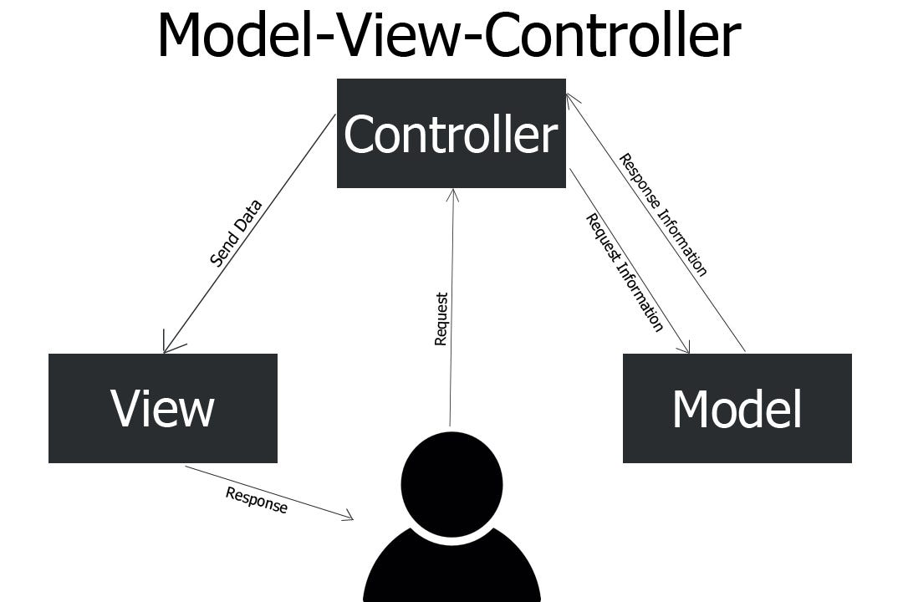
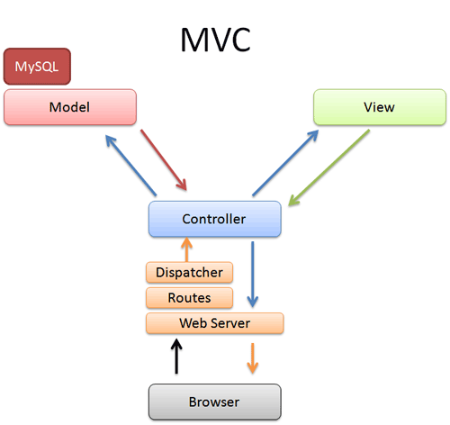

# Лабораторна робота №14. Використання класів для створення моделей для архітектури MVC

[Перелік усіх робіт](../README.md)

## Мета роботи

Опанувати основні принципи роботи з моделями: створювати екземпляри класу з рядків БД, отримувати список і окремий запис, змінювати дані методами моделі. Відокремити підключення PDO й HTML-представлення від основного сценарію.

## Обладнання

Комп’ютер, **PHP 8.1, OSPanel 6+**, MariaDB, редактор коду та браузер. Альтернатива — XAMPP із PHP 8.1. Потрібні `pdo_mysql` і `mbstring`; параметри середовища — у [пам’ятці](../../ENVIRONMENT.md).

Потрібні знання класів із [ЛР 13](../lab-13/README.md), PDO з [лекції 9](../../Лекціі/lec-09/README.md) та простого поділу MVC з [лекції 12](../../Лекціі/lec-12/README.md).

## Теоретичні відомості

У цій роботі кожна сутність має власний повний клас моделі. У ЛР 15 порівняємо повторювані CRUD-операції та винесемо їх в універсальний клас; успадкування і зв’язки розглянемо в ЛР 16–17.

### MVC

MVC (Model–View–Controller) розділяє відповідальність між трьома частинами застосунку:

1. **Model — модель:** дані та операції з ними. У прикладі клас User виконує SQL і повертає екземпляри користувачів.
2. **View — представлення:** показ підготовлених даних. Це звичайний PHP-файл із HTML, `<?= ?>`, `foreach` та `if`.
3. **Controller — контролер:** перевірка запиту, виклик моделі та вибір представлення. Окремого класу контролера в прикладі ще немає; запит опрацьовує public/index.php.





Представлення може перебирати список і перевіряти, чи він порожній; SQL у ньому не виконують. Модель не формує HTML. У цьому прикладі оновлення даних не запускає автоматичні повідомлення для браузера: новий стан буде показано під час наступного запиту.

### Модель

Клас описує спільні властивості й методи, а екземпляр — конкретного користувача. Один рядок таблиці перетворюється на один об’єкт User. Масив, який повертає User::all(), містить такі об’єкти, а не рядки HTML.

| Метод | Результат |
| --- | --- |
| `new User($pdo)` | Порожній екземпляр із доступом до PDO; id ще null |
| `User::all($pdo)` | Масив User; за відсутності записів — порожній масив |
| `User::find($pdo, $id)` | User або null, якщо запис не знайдено |
| `User::create($pdo, $username, $email, $password)` | Новий User із присвоєним id |
| `$user->update()` | Виконання UPDATE профілю; пароль залишається незмінним |
| `$user->delete()` | true, якщо рядок видалено; тоді id екземпляра стає null |

Статичні all(), find(), create() викликають через `User::`, методи update() і delete() — через конкретний об’єкт і `$this`. Конструктор отримує вже створене з’єднання PDO; кожен екземпляр не відкриває власне підключення.

Підготовлені запити відокремлюють SQL від значень. Під час create() пароль перетворюється на хеш через password_hash(); у властивостях User зберігаються лише id, username та email. Список і картка не отримують пароль або хеш. update() змінює профіль, а не перезаписує хеш відкритим паролем.

## Хід роботи

1. **Підготуйте середовище.** Запустіть вебсервер проєкту та MariaDB. Переконайтеся, що вибрано PHP 8.1 з pdo_mysql і mbstring.
2. **Створіть окремий проєкт або каталог роботи.** Скопіюйте src у власний навчальний проєкт OSPanel або XAMPP. Коренем сайту задайте **src/public**, щоб app залишався поза публічним каталогом. Інші проєкти не очищуйте.
3. **Розгляньте просту модель User і поділ файлів.** Структура спирається на app і public із лекції 12. Усі PHP-підключення виконує public/index.php; окремих контролерів поки немає:

```text
src/
    app/
        config/
            database.php       # створення й повернення PDO
        models/
            User.php           # модель
        views/
            users/
                v_index.php       # список екземплярів
                v_show.php       # один екземпляр
    public/
        index.php              # запит і всі PHP-підключення
        css/
            app.css            # оформлення
    schema.sql                 # структура та навчальні записи
```

Приклад зосереджений на зв’язку моделі з представленнями: у ньому немає окремого шару перевірок, HTTP-статусів і перехоплення помилок. Коректні реквізити та дані готуються заздалегідь.

public/index.php підключає модель, файл PDO й обране представлення через фіксовані шляхи. У моделі, файлі підключення та шаблонах немає require/include інших PHP-файлів. Відкривайте сайт через public, а не app/views.

У власній порожній базі виконайте [schema.sql](src/schema.sql). Таблиця users має id, username, email і password. Поле password зберігає **хеш**, його довжина — 255 символів. Якщо таблиця з такою назвою вже існує в іншому проєкті, не видаляйте її: використайте окрему навчальну базу.

schema.sql також додає два вигадані навчальні записи. Поле password містить готовий хеш, отриманий password_hash(); для навчальної перевірки використано demo-pass. У готовому прикладі немає форми входу, пароль не виводиться.

Відкрийте `http://ваш-домен/index.php`, для картки додайте `?id=1`, замінивши 1 фактичним id. Для перевірки через вбудований сервер PHP із каталогу src виконайте:

```bash
php -S 127.0.0.1:8000 -t public
```

Адреса — `http://127.0.0.1:8000/index.php`. Запускайте команду в середовищі PHP 8.1 з налаштованими реквізитами БД.

4. **На основі попередньої роботи й варіанта створіть власний проєкт.** Збережіть той самий простий розподіл відповідальностей. Імена класу, таблиці й властивостей адаптуйте до своєї предметної області.
5. **Створіть ще один клас моделі для обраної предметної області на додачу до User.** Наприклад, Product для каталогу товарів, Book для бібліотеки або Advertisement для дошки оголошень. Для нього створіть окремий файл у app/models і відповідну таблицю БД. Визначте властивості за змістом сутності та реалізуйте за зразком User методи all(), find(), create(), update(), delete(). Додайте прості представлення v_index.php і v_show.php в окремій папці цієї моделі в app/views; підключайте потрібні файли через public/index.php. Порівняйте результат all() з одним екземпляром find(). Перед шаблоном перевіряйте випадок null; у списку — порожній масив. Дані з БД не повинні ставати новими динамічними властивостями випадково.
6. **Винесіть PDO в окремий файл і використайте два представлення.** У прикладі app/config/database.php містить прості змінні хоста, порту, бази, користувача й пароля та повертає PDO з utf8mb4, режимом винятків та серверною підготовкою. Значення DB_HOST, DB_PORT, DB_NAME, DB_USER, DB_PASSWORD із середовища замінюють навчальні значення у файлі. Задайте власні реквізити локально; не публікуйте пароль. Налаштування вебпроцесу й консолі перевіряйте окремо.

У public/index.php всі підключення мають вигляд:

```php
require_once dirname(__DIR__) . '/app/models/User.php';
$pdo = require dirname(__DIR__) . '/app/config/database.php';
$users = User::all($pdo);
require dirname(__DIR__) . '/app/views/users/v_index.php';
```

Це скорочений фрагмент. Повний public/index.php підключає PDO, обирає список або картку за наявністю id і підключає відповідний шаблон. Шляхи шаблонів фіксовані: введення користувача не передається безпосередньо в require.

Шаблон бачить змінні, визначені перед його підключенням. Для списку передається `$users`, для картки — `$user`. Повідомлення про відсутній запис формує сам шаблон картки. Використовуйте прості PHP-конструкції:

```php
<?php foreach ($users as $item): ?>
    <p>
        <a href="index.php?id=<?= $item->id ?>"><?= e($item->username) ?></a>
    </p>
<?php endforeach; ?>
```

Для одного екземпляра:

```php
<?php if ($user !== null): ?>
    <h2><?= e($user->username) ?></h2>
    <p><?= e($user->email) ?></p>
<?php endif; ?>
```

Функція e() викликає htmlspecialchars() з ENT_QUOTES та UTF-8. Застосовуйте її до тексту й HTML-атрибутів; числовий id у прикладі вже має тип int. У шаблонах дозволені цикли й умовне відображення, а доступ до БД залишається в моделі. Оформлення зберігається в одному CSS-файлі.

7. **Для авторизованих користувачів додайте редагування та видалення.** Використайте перевірку входу вашого навчального проєкту. Готовий приклад показує тільки список і картку; він не реалізує вхід, ролі або вебформи зміни даних. Не вважайте відкриту сторінку дозволом редагувати всі записи.

Перед зміною перевірте права на конкретний запис. GET відкриває форму, POST викликає update() або delete(); додайте CSRF-токен за підходом ЛР 7. Перевірте типи полів до виклику методів. Перевірки полів додайте у власному обробнику форми; готова модель показує лише операції з даними. Пароль не обрізають через trim().

Приклад зміни вже знайденого екземпляра:

```php
$user = User::find($pdo, $id); // $id вже перевірено.
if ($user !== null) {
    $user->username = 'Оновлене навчальне ім’я';
    $user->email = 'updated@example.test';
    $user->update();
}
```

У вебобробнику цей виклик розміщують після перевірок POST, прав і CSRF, а після успіху перенаправляють на GET зі статусом 303. Невідомий id не повинен створювати нового користувача. Конфлікт унікальності email обробляйте як помилку форми; інші помилки БД не оголошуйте дублікатами.

update() повертає true після успішного виконання SQL, навіть якщо значення не змінилися. За потреби підтверджуйте стан повторним find(). Для видалення знайденого запису викликайте `$user->delete()`. Метод повертає false, якщо рядка немає або id дорівнює null; успішне видалення скидає id об’єкта, але не знищує змінну в коді, що викликав метод. Паролі й хеші не показуйте в жодному представленні.

8. **Перевірте HTML.** Через [W3C Markup Validation Service](https://validator.w3.org/) перевірте сформовані сторінки списку, картки й помилки. Передавайте у валідатор HTML-відповідь, а не PHP-шаблон.
9. Створіть у своєму навчальному репозиторії web-progr папку `lab 14` або використайте узгоджену викладачем назву. Додайте кінцеві PHP-файли, шаблони, CSS, структуру БД і короткий опис запуску. Секретні значення змінних не публікуйте.
10. Для ключових етапів додайте до звіту підписані знімки списку, картки, результату редагування та помилкового запиту.
11. Додайте код нового класу моделі, SQL його таблиці та обох представлень; відокремте власні зміни від готового прикладу User.
12. Дайте відповіді на контрольні питання.
13. Додайте до звіту посилання на папку лабораторної в репозиторії.
14. Збережіть звіт у PDF.
15. Додайте звіт до навчального репозиторію.

## Перевірка та очікуваний результат

| Сценарій | Очікуваний результат |
| --- | --- |
| База без користувачів | Порожній список без помилок |
| Список і перехід за посиланням | У картці саме вибраний користувач |
| Некоректний або відсутній у БД id | У картці повідомлення «Користувача не знайдено» |
| Ім’я `<b>Студент</b>` або з апострофом | Збережено точно, у шаблоні показано як текст |
| create() з коректними даними | Новий id; у БД хеш, в об’єкті та HTML немає пароля |
| update() профілю | Змінено ім’я/пошту; хеш пароля не змінився |
| Видалення створеного тестового запису | find() повертає null, id видаленого екземпляра — null |
| Повторна пошта | UNIQUE-індекс БД відхиляє дублікат; модель передає виняток PDO |
| Немає входу, прав або правильного CSRF-токена у власних формах | Зміни не виконуються |

Запишіть фактичні результати перевірок. Готовий приклад демонструє модель і два представлення; ваш результат — такий самий поділ для сутностей власного варіанта з доданими захищеними операціями зміни. Оцінювання — за критеріями [робочої програми](../../+РПНД%20WП%202023+.docx), без окремої нової бальної шкали.

## Приклади

1. [Головний сценарій](src/public/index.php).
2. [Клас моделі User](src/app/models/User.php).
3. [Підключення PDO](src/app/config/database.php).
4. [Представлення списку](src/app/views/users/v_index.php).
5. [Представлення одного користувача](src/app/views/users/v_show.php).
6. [Структура таблиці](src/schema.sql) та [оформлення](src/public/css/app.css).

## Контрольні питання

1. Чим відрізняються клас, екземпляр і рядок таблиці БД?
2. Яку роль у прикладі виконують public/index.php, app/models/User.php та app/views/users?
3. Чому з’єднання PDO створюється окремо й передається моделі?
4. Чим відрізняються статичні all()/find()/create() від методів update()/delete() екземпляра?
5. Як перевірити null від find() та порожній масив від all()?
6. Як змінні потрапляють у шаблон після require?
7. Чому foreach та if доречні в шаблоні, а SQL — у моделі?
8. Для чого потрібна функція e() і чому `<?= ?>` не екранує дані автоматично?
9. Чому оновлення профілю не повинно перезаписувати хеш пароля?
10. Чому unset() усередині методу не є способом видалити змінну коду, що викликав метод?

## Джерела

1. PHP Documentation Group. [Classes and Objects: The Basics](https://www.php.net/manual/en/language.oop5.basic.php).
2. PHP Documentation Group. [PDO::prepare](https://www.php.net/manual/en/pdo.prepare.php).
3. PHP Documentation Group. [PDOStatement::fetch](https://www.php.net/manual/en/pdostatement.fetch.php).
4. PHP Documentation Group. [include: variable scope](https://www.php.net/manual/en/function.include.php).
5. PHP Documentation Group. [Alternative syntax for control structures](https://www.php.net/manual/en/control-structures.alternative-syntax.php).
6. PHP Documentation Group. [htmlspecialchars](https://www.php.net/manual/en/function.htmlspecialchars.php).
7. PHP Documentation Group. [password_hash](https://www.php.net/manual/en/function.password-hash.php).
8. OWASP. [Cross-Site Request Forgery Prevention Cheat Sheet](https://cheatsheetseries.owasp.org/cheatsheets/Cross-Site_Request_Forgery_Prevention_Cheat_Sheet.html).

## Довідники та додаткові матеріали

Посилання попередньої редакції збережено для відстежуваності. Сторінки PHP Manual наведено англійською: [PDO](https://www.php.net/manual/en/book.pdo.php), [Hash Functions](https://www.php.net/manual/en/ref.hash.php), [Sessions](https://www.php.net/manual/en/book.session.php). [md5()](https://www.php.net/manual/en/function.md5.php) не призначена для зберігання паролів; у прикладі використовується password_hash().

[Відео PHP + PDO](https://www.youtube.com/watch?v=a9l3QPMqZ1Q) та [W3Schools: Sessions](https://www.w3schools.com/php/php_sessions.asp) залишено як додаткові матеріали; їхній поточний зміст не перевірено, до перевіреного мінімуму джерел вони не входять.

## Альтернативні теми за варіантами

Варіант для виконання індивідуального завдання:

1. Каталог товарів продуктового магазину
2. Каталог книг у бібліотеці
3. Дошка оголошень
4. Фотогалерея
5. Каталог запчастин автомобілів
6. Індивідуальний електронний записник
7. Каталог рієлтора
8. Каталог бази будівельних матеріалів
9. Власний блог
10. Розклад маршрутів автовокзалу
