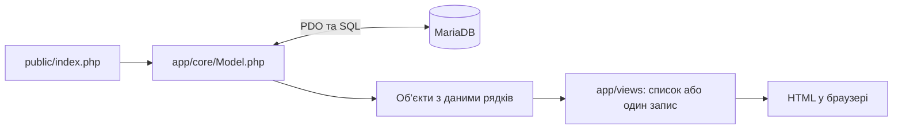

[Перелік усіх робіт](../README.md)

# Лабораторна робота №15. Створення класу універсальної моделі

## Мета роботи

Узагальнити операції роботи з базою даних із ЛР 14 в одному класі `Model`. Навчитися налаштовувати його для різних таблиць, виконувати CRUD та передавати об’єкти у прості PHP-шаблони. Підготувати клас для подальшого успадкування.

## Обладнання та передумови

PHP 8.1 із `pdo_mysql`, MariaDB 11.x, OSPanel 6+; альтернатива — XAMPP із відповідними версіями PHP і сервера БД. Редактор коду та браузер. Дотримуйтеся [вимог середовища](../../ENVIRONMENT.md). Потрібен досвід виконання [ЛР 14](../lab-14/README.md).

## Теоретичні відомості

### Від окремих моделей до спільних операцій

У ЛР 14 моделі різних сутностей виконували схожі операції: отримання списку, пошук за `id`, додавання, оновлення та видалення. Відрізнялися переважно назви таблиць і полів. Перенесемо спільний код у `Model`, а налаштування передаватимемо через конструктор.

У цій роботі створюємо **лише універсальний клас `Model`**. Окремі класи сутностей та їх успадкування реалізовуватимемо в наступній лабораторній. Поки що назву таблиці передаємо аргументом методів одного класу.



Контролерів на цьому етапі немає. Вибір операції й усі підключення файлів залишаються в `public/index.php`. Клас працює з даними, а шаблони формують HTML.

### Налаштування та атрибути

```php
$item = new Model($pdo, 'products');
```

Конструктор отримує PDO, назву таблиці та необов’язковий масив даних рядка. Перелік полів отримується з MariaDB командою `SHOW COLUMNS`. Для наочності це відбувається під час створення кожного об’єкта; на великих списках такий підхід виконує зайві запити. У наступній роботі додамо `$defaultTable`, щоб назву таблиці задавав клас-нащадок.

| Властивість | Призначення |
| --- | --- |
| `$pdo` | З’єднання з базою даних |
| `$table` | Назва таблиці |
| `$fields` | Перелік стовпців таблиці, отриманий із БД |
| `$attributes` | Значення полів одного рядка, включно з `id` |

Властивості мають видимість `protected`: доступні всередині класу та його майбутніх нащадків. З’єднання і назва таблиці належать екземпляру. Їх не слід зберігати як спільний статичний стан: два екземпляри можуть працювати з різними таблицями.

`__get()` дозволяє читати `$item->title`, хоча дані зберігаються в масиві атрибутів. `__set()` змінює поле лише в пам’яті. Присвоєння саме по собі **не виконує SQL**: для збереження викликають `save()` або `update()` з масивом змін. Невідомі поля та присвоєння `id` через `__set()` ігноруються.

Універсальність прикладу має прості межі: таблиця повинна мати цілий первинний ключ `id` з `AUTO_INCREMENT` і звичайні поля з простими назвами. Обчислювані стовпці, автоматичні зв’язки, складені ключі та пагінація тут не реалізовані.

### Основні операції

| Виклик | Результат |
| --- | --- |
| `Model::all($pdo, $table)` | Масив об’єктів рядків; для порожньої таблиці — `[]` |
| `Model::find($pdo, $id, $table)` | Об’єкт одного рядка або `null` |
| `Model::create($pdo, $data, $table)` | Додає рядок і повторно читає його через `find()` |
| `$item->update($data)` | Оновлює дозволені поля рядка з його `id` |
| `$item->save()` | Зберігає атрибути: INSERT без `id`, UPDATE за наявності `id` |
| `$item->delete()` | Видаляє рядок; повертає `true`, якщо видалено один запис |

Як і в ЛР 14, `all()`, `find()`, `create()` — статичні: їх викликають через клас без попереднього створення об’єкта рядка. PDO і таблиця передаються аргументами. `update()`, `save()`, `delete()` працюють із конкретним екземпляром і використовують його `$this`. Об’єкти результату зберігають PDO, таблицю та власні атрибути.

`save()` без `id` викликає `create()` та переносить отримані атрибути, включно з новим `id`, у поточний об’єкт. З `id` він передає всі атрибути, крім ключа, у `update()`. Перед першим збереженням заповніть усі потрібні поля: незаповнені атрибути мають значення `null`. Для часткової зміни використовуйте `update($data)`.

Усередині читання використано `new static(...)`. Зараз створюється `Model`, а після успадкування це дозволить повертати об’єкти класу-нащадка. Майбутній нащадок повинен зберегти сумісний конструктор. Нових класів для демонстрації успадкування в цій роботі не додаємо.

`create()` відкидає невідомі поля й `id`; без дозволених даних виникає виняток. `update()` без ідентифікатора або змін повертає `false`. Його результат `true` означає успішне виконання запиту, а не обов’язкову зміну рядка: значення могли збігатися або рядок уже видалено. Стан можна повторно прочитати через `find()`. Помилки SQL передаються як винятки PDO.

### Безпека та межі відповідальності

Значення передаються через параметри підготовлених запитів. Назву таблиці не можна підставити через `?`: її задаємо в коді та перевіряємо як простий SQL-ідентифікатор. Ключі даних обмежуються стовпцями з `SHOW COLUMNS`, крім `id`. Наявність стовпця не означає дозвіл користувачу його змінювати: передавайте лише явно вибрані поля. Не беріть назву таблиці з URL та не передавайте весь `$_POST` без перевірки вмісту.

Валідацію значень виконуйте до запису: наприклад, назва не порожня, ціна невід’ємна. Перелік дозволених полів не замінює валідацію. У шаблонах текст проходить через `e()`, що використовує `htmlspecialchars()` для захисту від XSS. Демонстраційні сторінки лише читають дані. Якщо додаєте форми зміни даних, використовуйте POST і перевірку CSRF-токена.

## Хід роботи

1. Запустіть PHP і MariaDB у вибраному середовищі. Створіть окремий проєкт для ЛР 15, не очищуючи спільні каталоги.
2. Порівняйте дві моделі з власної ЛР 14. Визначте спільні операції та змінні частини: таблицю і поля.
3. Розгляньте структуру нового прикладу:

   ```text
   src/
   ├── app/
   │   ├── config/
   │   │   └── database.php
   │   ├── core/
   │   │   └── Model.php
   │   └── views/
   │       ├── v_index.php
   │       └── v_show.php
   ├── public/
   │   ├── css/app.css
   │   └── index.php
   └── schema.sql
   ```

   `app/core` містить спільний клас. Папка `app/models` знадобиться для конкретних моделей у наступній роботі. Коренем вебсервера має бути `src/public`, щоб конфігурація та ядро не були доступні через HTTP.

4. Створіть власну навчальну базу `lab15` у кодуванні `utf8mb4`. Один раз виконайте [schema.sql](src/schema.sql) у порожній базі. Він створює таблицю `products` і три початкові записи. Налаштуйте користувача БД із правами читання та CRUD для цієї бази.
5. Перевірте [конфігурацію PDO](src/app/config/database.php). Задайте власні `DB_HOST`, `DB_PORT`, `DB_NAME`, `DB_USER`, `DB_PASSWORD` у середовищі проєкту або змініть навчальні значення локально. Не публікуйте справжні паролі. Підключення використовує `utf8mb4`, винятки PDO та справжні підготовлені запити.
6. Послідовно розберіть [Model.php](src/app/core/Model.php): конструктор, доступ до атрибутів, читання, додавання, оновлення, видалення. Знайдіть місця відсіювання недозволених полів і передавання параметрів SQL.
7. Відкрийте список у браузері. Перейдіть до одного запису та поверніться назад. Перевірте неіснуючий `id`. Зіставте параметри шаблонів із даними, які передає `index.php`.
8. Перевірте CRUD на тимчасовому записі. Для короткої демонстрації додайте фрагмент нижче в `public/index.php` після визначення `$table`, виконайте один раз і приберіть перед звичайним переглядом. Не створюйте посилань видалення через GET.

   ```php
   $item = Model::create($pdo, [
       'title' => 'Навчальний товар',
       'price' => '15.50',
   ], $table);

   echo e($item->title);
   $item->update(['price' => '18.00']);
   $saved = Model::find($pdo, $item->id, $table);
   echo e((string) $saved->price);
   $item->title = 'Змінена назва';
   $item->save(); // UPDATE атрибутів наявного рядка.
   $item->delete();

   $draft = new Model($pdo, $table);
   $draft->title = 'Новий товар';
   $draft->price = '20.00';
   $draft->save(); // INSERT; об’єкт отримує id.
   $draft->delete();
   ```

   Фрагмент передбачає коректні дані та успішне додавання. Грошову суму передаємо десятковим рядком, а в БД зберігаємо в `DECIMAL(10,2)`.

9. Адаптуйте приклад до предметної області ЛР 14. Збережіть один універсальний `Model`; задайте назви таблиць і підписи колонок у `index.php`. Передавайте в методи лише потрібні поля. Перевірте незалежну роботу щонайменше з двома таблицями та обидва режими `save()`. **Окремі класи сутностей не створюйте.**
10. Зафіксуйте результати перевірок: початкові дані, виклик методу, результат. Додайте до звіту знімки списку, одного запису та результатів CRUD із поясненнями.
11. Дайте відповіді на контрольні питання, додайте код самостійно виконаного завдання і висновок про усунення дублювання.
12. Розмістіть кінцеві файли в папці `lab-15` власного репозиторію `web-progr` на GitHub. Додайте посилання на папку у звіт, збережіть звіт як PDF і додайте його до репозиторію.

### Мінімальна перевірка

| Дія | Очікуваний результат |
| --- | --- |
| Отримати список | Об’єкти з даними початкових рядків |
| Знайти наявний / відсутній `id` | Об’єкт / `null`; відповідний стан у шаблоні |
| Додати назву з апострофом | Текст збережено без пошкодження SQL |
| Оновити лише ціну | Назва та `id` не змінилися |
| Передати зайве поле або `id` у даних | Вони не потрапили до INSERT/UPDATE |
| Видалити тимчасовий рядок | `true`, наступний пошук повертає `null` |
| Викликати статичні методи для двох таблиць | Кожен виклик працює з переданою таблицею |
| Викликати `save()` до та після отримання `id` | Спочатку INSERT, потім UPDATE без нового рядка |
| Вивести текст `<b>Тест</b>` | Браузер показує текст, а не застосовує тег |

## Приклади та очікуваний результат

- [Точка входу та всі підключення](src/public/index.php).
- [Універсальний клас Model](src/app/core/Model.php).
- [Підключення PDO](src/app/config/database.php).
- [Список записів](src/app/views/v_index.php) і [один запис](src/app/views/v_show.php).
- [SQL для початкових даних](src/schema.sql).

Результат — універсальний клас із CRUD, дві сторінки перегляду та перевірка класу на таблицях власної предметної області. SQL зосереджено в `Model`, підключення — в `index.php`, розмітку — у видах. Шаблони використовують звичайні `<?= ?>`, `foreach` та `if`.

## Контрольні питання

1. Який код із ЛР 14 вдалося узагальнити? Що залишилося налаштуваннями?
2. Чому all(), find(), create() статичні, а update(), save(), delete() — методи екземпляра?
3. Для чого потрібні `$this` і видимість `protected`?
4. Як працюють `__get()` та `__set()`? Як save() зберігає присвоєні значення?
5. Чому назви таблиці й полів не можна передати параметрами PDO?
6. Як клас обмежує поля для INSERT та UPDATE?
7. Що повертають `find()`, `update()` і `delete()`?
8. Чому з’єднання і назва таблиці є властивостями екземпляра?
9. Для чого використано `new static`?
10. Чим валідація даних відрізняється від екранування HTML?

## Джерела

1. PHP Documentation Group. [Object Inheritance](https://www.php.net/manual/en/language.oop5.inheritance.php).
2. PHP Documentation Group. [Visibility](https://www.php.net/manual/en/language.oop5.visibility.php).
3. PHP Documentation Group. [Overloading: __get та __set](https://www.php.net/manual/en/language.oop5.overloading.php).
4. PHP Documentation Group. [Late Static Bindings](https://www.php.net/manual/en/language.oop5.late-static-bindings.php).
5. PHP Documentation Group. [PDO::prepare](https://www.php.net/manual/en/pdo.prepare.php).
6. PHP Documentation Group. [PDOStatement::execute](https://www.php.net/manual/en/pdostatement.execute.php).
7. PHP Documentation Group. [htmlspecialchars](https://www.php.net/manual/en/function.htmlspecialchars.php).
8. PHP Documentation Group. [Static Keyword](https://www.php.net/manual/en/language.oop5.static.php).

## Альтернативні теми за варіантами

Варіант для виконання самостійних завдань

1. Каталог товарів продуктового магазину
2. Каталог книг у бібліотеці
3. Дошка оголошень
4. Фотогалерея
5. Каталог запчастин автомобілів
6. Індивідуальний електронний записник
7. Каталог рієлтора
8. Каталог бази будівельних матеріалів
9. Власний блог
10. Розклад маршрутів автовокзалу
