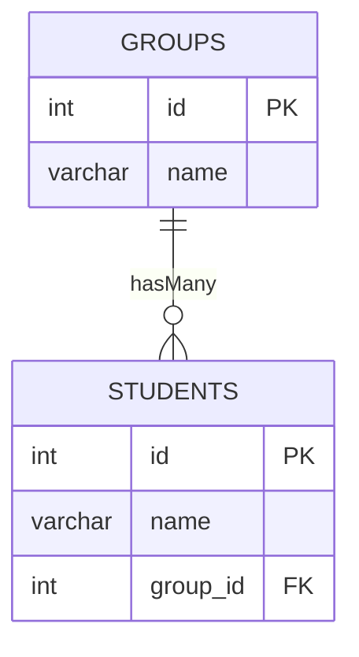

[Перелік усіх робіт](../README.md)

# Лабораторна робота №17. Створення класу визначеної моделі ч.2

## Мета роботи

Доповнити універсальну модель зв’язками hasMany і belongsTo та визначити їх у класах-нащадках.

## Обладнання

PHP 8.1, PDO MySQL, MariaDB 11.x, OSPanel 6+ або XAMPP із відповідними версіями. Редактор коду та браузер. [Вимоги середовища](../../ENVIRONMENT.md).

## Теоретичні відомості

У [ЛР 16](../lab-16/README.md) створено класи-нащадки для сутностей. Тепер доповнюємо той самий `Model` методами зв’язків, зберігаючи `all()`, `find()`, `create()`, `update()`, `save()`, `delete()`.

Одна група має багато студентів; кожен студент належить одній групі або ще не має її. Зовнішній ключ `students.group_id` посилається на `groups.id`.



`hasMany(Student::class, 'group_id')` шукає рядки таблиці студентів, де зовнішній ключ дорівнює `id` поточної групи, і повертає масив `Student`. `belongsTo(Group::class, 'group_id')` бере ключ із поточного студента та повертає `Group` або `null`. Порожній результат `hasMany()` — `[]`. Обидва методи захищені (`protected`); назовні нащадки надають зрозумілі методи `students()` і `group()`.

```php
class Group extends Model
{
    protected static string $defaultTable = 'groups';

    public function students(): array
    {
        return $this->hasMany(Student::class, 'group_id');
    }
}

class Student extends Model
{
    protected static string $defaultTable = 'students';

    public function group(): ?Group
    {
        return $this->belongsTo(Group::class, 'group_id');
    }
}
```

Зв’язок у PHP не створює зовнішнього ключа в БД: його окремо визначає SQL. У прикладі `ON DELETE SET NULL` залишає студентів після видалення групи, тому `group_id` допускає `NULL`. Методи лише читають пов’язані записи, не зберігають і не видаляють їх автоматично. Кожен виклик виконує запит; кешування та попереднє завантаження тут не додаємо. Для незбереженої групи `students()` повертає `[]`.

Значення ключів передаємо параметрами PDO; назви класів і ключів задаємо в методах нащадків. У HTML використовуємо `e()`. Перед зміною даних потрібні валідація, POST і CSRF-захист. Усі підключення залишаються в `index.php`, контролерів немає. Чинні шляхи прикладу `src/core`, `src/models`, `src/index.php` збережено; `core` відповідає `app/core` з ЛР 16. Файли `core` слід закрити від HTTP-доступу конфігурацією локального сервера.

## Хід роботи
1. Запустіть PHP 8.1 і MariaDB 11.x у своєму середовищі.
2. Створіть окремий проєкт `lab-17`, не очищуючи спільні каталоги. Створіть базу `lab17`, виконайте [schema.sql](src/schema.sql) і налаштуйте PDO. Підключення: спочатку `core/config.php`, потім `core/connection.php`.
3. Візьміть за основу класи-нащадки з ЛР 16. Визначте дві пов’язані сутності та зовнішній ключ.
4.  Розгляньте приклад за посиланням, поданим нижче.
5.  Зробіть рефакторінг коду минулого проекту:
    1.  Використовуючи, як основу, проект попередньої лабораторної роботи виконайте вдосконалення
    2.  Доопрацюйте клас `Model`
    3.  Для дочірніх класів, що пов'язані між собою логічно, зробіть методи, що зв'язують їх.
    4.  Перевірте коректність роботи проекту після рефакторінгу
    5. Перевірте групу зі студентами, порожню групу, студента без групи та обидва напрямки зв’язку. Переконайтеся, що CRUD із ЛР 16 працює.
6.  Для проекту створіть папку "lab 17" в своєму репозиторії "web-progr" на Github. Завантажте кінцеві файли лабораторної роботи. 
7.  Для кожного етапу роботи зробіть знімки екрану та додайте їх у звіт з описом кожного скіншота
8.  Додайте програмний код завдання для самомтійного виконання
9.  Дайте відповіді на контрольні запитання
10. Додайте в кінці звіту посилання на репозиторій та папку з лабораторною роботою
11. Збережіть звіт у форматі PDF
12. Додайте звіт до репозиторія

## Приклади

1. [Точка входу](src/index.php), [Model](src/core/Model.php), [Group](src/models/Group.php), [Student](src/models/Student.php).

Очікуваний результат: список груп із пов’язаними студентами та список студентів із назвою їхньої групи; відсутні зв’язки відображаються повідомленням.


## Контрольні питання

1. Чим hasMany відрізняється від belongsTo?
2. У якій таблиці зберігається зовнішній ключ?
3. Чому зв’язок у PHP не замінює FOREIGN KEY у БД?
4. Які об’єкти повертають students() і group()?
5. Як обробити порожній масив і null у представленні?
6. Для чого параметризувати значення зовнішнього ключа?
7. Які методи Model залишилися з ЛР 16 без змін?

## Джерела

1. PHP Documentation Group. [Object Inheritance](https://www.php.net/manual/en/language.oop5.inheritance.php).
2. PHP Documentation Group. [Visibility](https://www.php.net/manual/en/language.oop5.visibility.php).
3. PHP Documentation Group. [Late Static Bindings](https://www.php.net/manual/en/language.oop5.late-static-bindings.php).
4. PHP Documentation Group. [PDO::prepare](https://www.php.net/manual/en/pdo.prepare.php).
5. PHP Documentation Group. [PDOStatement::execute](https://www.php.net/manual/en/pdostatement.execute.php).
6. PHP Documentation Group. [htmlspecialchars](https://www.php.net/manual/en/function.htmlspecialchars.php).

## Довідники та додаткові матеріали

1. [Объекты данных PHP](https://www.php.net/manual/ru/book.pdo.php)
2. [PHP + PDO. Работа с MySQL](https://www.youtube.com/watch?v=a9l3QPMqZ1Q)
3. [PHP md5()](https://www.php.net/manual/ru/function.md5.php)
4. [Функции Hash](https://www.php.net/manual/ru/ref.hash.php)
5. [Session Handling](https://www.php.net/manual/en/book.session.php)
6. [PHP Sessions](https://www.w3schools.com/php/php_sessions.asp)

## Альтернатвні теми за варіантами

Варіяант для виконання самостійних завдань

1. Каталог товарів продуктового магазину
2. Каталог книг у бібліотеці
3. Дошка оголошень
4. Фотогалерея
5. Каталог запчастин автомобілів
6. Індивідуальний електронний записник
7. Каталог рієлтора
8. Каталог бази будівельних матеріалів
9. Власний блог
10. Розклад маршрутів автовокзалу