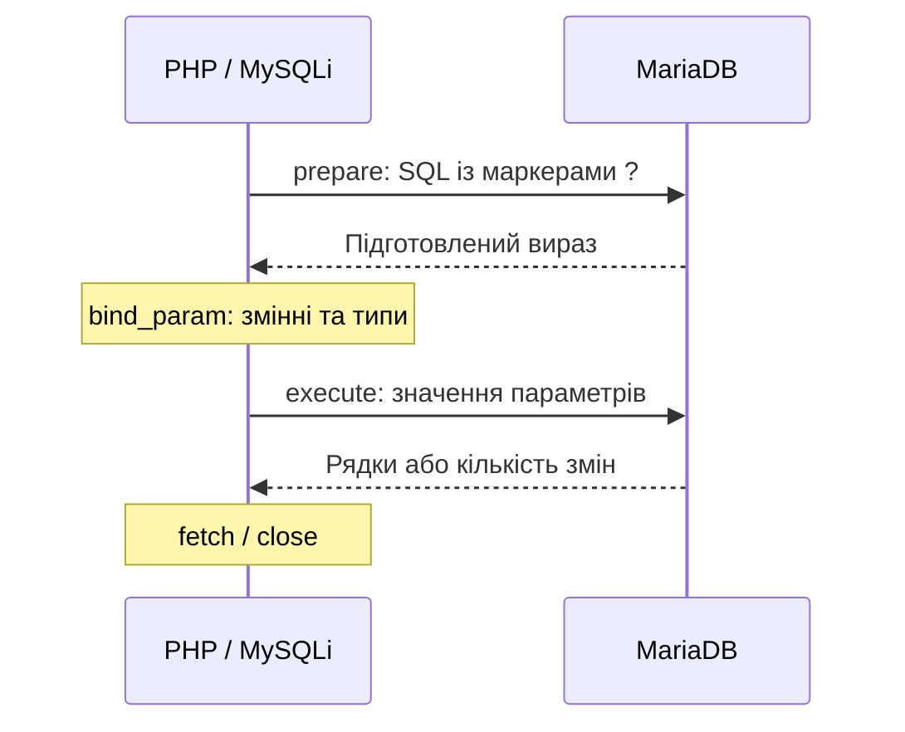

# Лекція 8. Організація роботи з СУБД MySQL: MySQLi

[Перелік лекцій](../README.md)

## Мета лекції

Навчитися підключати PHP до реляційної бази, виконувати підготовлені запити MySQLi, читати результати та обробляти помилки. Розрізняти валідацію введення, параметризацію SQL і захист HTML-виведення.

Навчальне середовище — **PHP 8.1, OSPanel 6+**, альтернатива — XAMPP із PHP 8.1; див. [пам’ятку](../../ENVIRONMENT.md). Потрібні розширення `mysqli`, `mbstring` та запущена MariaDB. MySQLi працює через сумісний протокол MySQL; у прикладах використовуємо об’єктний інтерфейс цього розширення.

## 1. Від HTTP-запиту до таблиці

PHP перевіряє дані й надсилає SQL до MariaDB, яка зберігає записи та виконує пошук. Браузер не отримує реквізитів підключення.


У власній навчальній базі створіть таблицю товарів; [schema.sql](src/schema.sql) також містить два початкові записи.

```sql
CREATE TABLE products (
    id INT UNSIGNED AUTO_INCREMENT PRIMARY KEY,
    title VARCHAR(80) NOT NULL,
    stock INT UNSIGNED NOT NULL
) ENGINE=InnoDB DEFAULT CHARSET=utf8mb4;
```

`id` визначає запис, `title` — назву, `stock` — кількість. InnoDB підтримує транзакції. Таблицю створюють окремо від HTTP-обробників.

## 2. Підключення й кодування

Реквізити задають у середовищі процесу PHP: `DB_HOST`, `DB_PORT`, `DB_NAME`, `DB_USER`, `DB_PASSWORD`. Хост і порт беріть із налаштувань вибраного модуля MariaDB в OSPanel; порт 3306 не є універсальною вимогою. Використовуйте окремого користувача з потрібними правами на навчальну базу.

[connection.php](src/connection.php) перевіряє реквізити й надає функцію `connectDatabase()`. Пароль не записують у репозиторій. Основні дії:

```php
mysqli_report(MYSQLI_REPORT_ERROR | MYSQLI_REPORT_STRICT);
$db = new mysqli();
$db->options(MYSQLI_OPT_CONNECT_TIMEOUT, 5);
$db->real_connect($host, $user, $password, $database, $port);
$db->set_charset('utf8mb4');
```

Змінні тут містять перевірені налаштування. `options()` задають **до** підключення. `set_charset()` налаштовує обмін текстом; кодування таблиці задають окремо. PHP-файли зберігайте у UTF-8 без BOM.

STRICT перетворює помилки MySQLi на `mysqli_sql_exception`. Обробляйте їх через `try/catch`. Далі `$db` позначає вже створене з’єднання.

## 3. Підготовлені запити: SQL окремо від значень

Не склеюйте введення користувача з SQL. У шаблоні залишають `?`, а значення передають через `bind_param()`. Апостроф у назві тоді залишається частиною даних і не змінює структуру запиту.



Типи `bind_param()`: `i` — ціле, `d` — число з рухомою крапкою, `s` — рядок, `b` — бінарні дані. Кількість літер відповідає маркерам; змінні передаються за посиланням. Прив’язка типу не замінює валідації.

Маркери позначають **значення**, а не назви таблиць чи стовпців. Сортування обирайте з фіксованого переліку в коді. Сталий SQL без зовнішніх значень можна виконати через `$db->query()`.

## 4. INSERT: перевірити й додати

Для форми перевіряємо назву після `trim()` і цілу кількість 0–1000000. Межі — умови прикладу.

```php
$title = $_POST['title'] ?? null;
$rawStock = $_POST['stock'] ?? null;
if (!is_string($title) || !is_string($rawStock)) {
    throw new InvalidArgumentException('Очікуються рядкові поля форми.');
}
$title = trim($title);
$stock = filter_var($rawStock, FILTER_VALIDATE_INT,
    ['options' => ['min_range' => 0, 'max_range' => 1000000]]);
if (!mb_check_encoding($title, 'UTF-8') || $title === ''
    || mb_strlen($title, 'UTF-8') > 80 || $stock === false) {
    throw new InvalidArgumentException('Неприпустимі назва або кількість.');
}
$stmt = $db->prepare('INSERT INTO products (title, stock) VALUES (?, ?)');
$stmt->bind_param('si', $title, $stock);
$stmt->execute();
$id = $db->insert_id;
$stmt->close();
```

Порівняння `$stock === false` зберігає допустимий нуль. Новий id отримують після успішного INSERT; не визначайте його через `MAX(id)`, бо інший запит може створити запис паралельно.

## 5. SELECT: знайти й безпечно показати

Перед пошуком перевірте id як додатне ціле число. Прочитайте або закрийте результат до наступного запиту.

```php
$rawId = $_GET['id'] ?? null;
$id = is_string($rawId)
    ? filter_var($rawId, FILTER_VALIDATE_INT,
        ['options' => ['min_range' => 1]])
    : false;
if ($id === false) {
    throw new InvalidArgumentException('Некоректний id.');
}
$stmt = $db->prepare('SELECT title, stock FROM products WHERE id = ?');
$stmt->bind_param('i', $id);
$stmt->execute();
$stmt->bind_result($foundTitle, $foundStock);
if ($stmt->fetch() === true) {
    echo htmlspecialchars($foundTitle, ENT_QUOTES | ENT_SUBSTITUTE, 'UTF-8');
    echo ' — ' . (int) $foundStock;
} else {
    echo 'Товар не знайдено.';
}
$stmt->close();
```

`bind_result()` зв’язує стовпці зі змінними, `fetch()` читає рядок. Список читають у циклі. Метод MySQLi `get_result()` повертає `mysqli_result`, але потребує mysqlnd. Тут використано bind_result(). Порожній результат не є помилкою SQL.

## 6. UPDATE, DELETE та кількість змін

Для вже перевірених `$id` і `$stock`:

```php
$stmt = $db->prepare('UPDATE products SET stock = ? WHERE id = ?');
$stmt->bind_param('ii', $stock, $id);
$stmt->execute();
$changed = $stmt->affected_rows;
$stmt->close();
```

`affected_rows` — **властивість**, не метод. За стандартних налаштувань нуль для UPDATE може означати відсутній запис або присвоєння того самого значення. Для перевірки існування виконайте SELECT; не оголошуйте нуль помилкою з’єднання.

```php
$stmt = $db->prepare('DELETE FROM products WHERE id = ?');
$stmt->bind_param('i', $id);
$stmt->execute();
$deleted = $stmt->affected_rows;
$stmt->close();
```

Не пропускайте WHERE: він обмежує зміну одним записом. У вебзастосунку INSERT, UPDATE і DELETE виконуйте після перевірки методу, прав доступу та CSRF-токена для cookie-автентифікації. GET не має видаляти дані. Після успішної POST-форми застосовуйте перенаправлення 303.

## 7. Транзакції та обробка помилок

Пов’язані зміни об’єднують через `begin_transaction()`: `commit()` підтверджує їх разом, `rollback()` скасовує. Це стосується транзакційних таблиць; створення таблиць не слід включати до такого демонстраційного циклу. Відкочування не гарантує повернення використаних AUTO_INCREMENT-номерів.

[demo.php](src/demo.php) — повний CLI-приклад: додає товар, змінює кількість, перевіряє її повторним SELECT, видаляє цей товар та відкочує транзакцію. Перед запуском створіть таблицю через schema.sql і задайте п’ять змінних середовища в консолі проєкту; виконайте `php demo.php`. Початкові товари не змінюються.

Журналюйте код і контекст помилки без паролів та введених даних. Користувачу повертайте нейтральне повідомлення й належний HTTP-статус. Відокремлюйте помилки валідації від збоїв БД. Закривайте вирази; з’єднання звільняйте в `finally`. Параметризація SQL, HTML-екранування та CSRF-захист виконують різні завдання.

## Контрольні питання

1. Яку роль виконують PHP, MySQLi та MariaDB у схемі обміну?
2. Для чого потрібні set_charset() та utf8mb4 у визначенні таблиці?
3. Чому параметри options() установлюють до підключення?
4. Як працює послідовність prepare → bind_param → execute?
5. Чому маркером ? не можна замінити назву таблиці?
6. Чому параметризація не замінює валідацію та HTML-екранування?
7. Чим відрізняються bind_result(), fetch() та get_result()?
8. Чому affected_rows = 0 для UPDATE потребує пояснення?
9. Що станеться з UPDATE або DELETE без WHERE?
10. Коли потрібні commit(), rollback(), перевірка прав і CSRF-токен?

## Джерела

1. PHP Documentation Group. [Connections](https://www.php.net/manual/en/mysqli.quickstart.connections.php).
2. PHP Documentation Group. [Prepared Statements](https://www.php.net/manual/en/mysqli.quickstart.prepared-statements.php).
3. PHP Documentation Group. [mysqli_stmt::bind_param](https://www.php.net/manual/en/mysqli-stmt.bind-param.php).
4. PHP Documentation Group. [mysqli_stmt::bind_result](https://www.php.net/manual/en/mysqli-stmt.bind-result.php).
5. PHP Documentation Group. [mysqli::$affected_rows](https://www.php.net/manual/en/mysqli.affected-rows.php).
6. PHP Documentation Group. [mysqli::set_charset](https://www.php.net/manual/en/mysqli.set-charset.php).
7. PHP Documentation Group. [mysqli::begin_transaction](https://www.php.net/manual/en/mysqli.begin-transaction.php).
8. PHP Documentation Group. [mysqli_stmt::get_result](https://www.php.net/manual/en/mysqli-stmt.get-result.php).
9. MariaDB. [CREATE TABLE](https://mariadb.com/docs/server/reference/sql-statements/data-definition/create/create-table).
