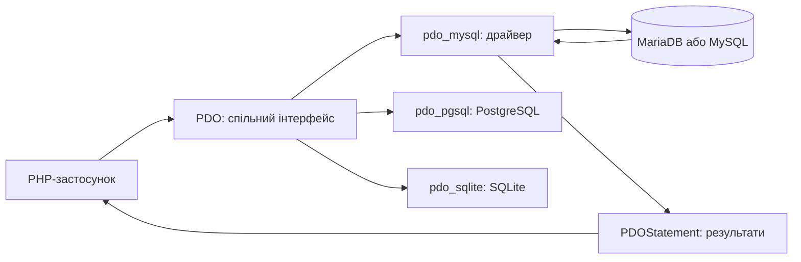
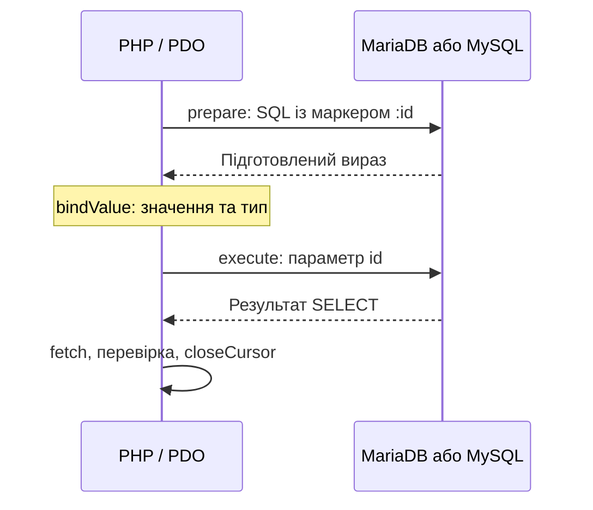

# Лекція 9. Альтернативні засоби під'єднання до СУБД MySQL

[Перелік лекцій](../README.md)

## Мета лекції

Зрозуміти архітектуру PDO, роль драйверів, переносимість SQL, виконання CRUD та обробку помилок.

Приклади — для **PHP 8.1** та pdo_mysql; теорія PDO стосується різних драйверів.

## 1. Вступ до PDO: що це і для чого потрібно

PDO (PHP Data Objects) — спільний об’єктний інтерфейс для різних СУБД. Доступ забезпечують окремі драйвери; приклади цієї лекції використовують `pdo_mysql` для MariaDB/MySQL.



PDO **не перекладає SQL автоматично**. Міграція між СУБД потребує перевірки DSN, типів, функцій SQL і транзакцій. MariaDB і MySQL також мають відмінності між версіями.

Захист від SQL-ін’єкцій забезпечує відокремлення SQL від параметрів, а не сама наявність PDO.

## 2. Архітектура PDO та роль драйверів

`PDO` представляє з’єднання, його атрибути й транзакції. `PDOStatement` — запит, параметри та читання результату. `PDOException` — виняток із кодом SQLSTATE; додаткова діагностика залежить від драйвера.

Драйвер перетворює методи PDO на операції СУБД і визначає DSN та підтримані атрибути. Однакові методи не означають однакових можливостей серверів.

| Драйвер | СУБД та префікс DSN | Особливість |
| --- | --- | --- |
| pdo_mysql | MySQL, MariaDB; `mysql:` | Клієнт-серверна БД |
| pdo_pgsql | PostgreSQL; `pgsql:` | Власні типи та діалект SQL |
| pdo_sqlite | SQLite; `sqlite:` | Вбудована БД у файлі або `sqlite::memory:` без окремого сервера |
| pdo_sqlsrv | Microsoft SQL Server; `sqlsrv:` | Залежить від Microsoft ODBC Driver та можливостей SQL Server |
| pdo_oci | Oracle; `oci:` | Доступ через Oracle Call Interface |

`sqlite::memory:` створює БД у пам’яті одного з’єднання; незалежне з’єднання її не бачить. Файлова SQLite використовує шлях замість хоста й порту. Серверні СУБД зберігають дані в окремому процесі й перевіряють права користувача.

`PDO::getAvailableDrivers()` показує драйвери поточного PHP-процесу, а не запущені сервери. Ім’я mysql позначає драйвер, а не розрізняє MariaDB та MySQL.

### Підготовка запиту: серверна та емульована

Серверна підготовка відокремлює SQL-шаблон і значення на сервері. Емуляцію виконує клієнтський драйвер; SQL-помилка може виявитися лише на execute(). Підтримка `ATTR_EMULATE_PREPARES` залежить від драйвера: цей атрибут не є універсальним.

## 3. Підключення до MariaDB та MySQL

DSN (Data Source Name) описує драйвер, хост, порт, базу й кодування; ім’я користувача та пароль передають окремо. Реквізити не беруть із HTTP-параметрів.

```php
$dsn = sprintf('mysql:host=%s;port=%d;dbname=%s;charset=utf8mb4',
    $host, $port, $database);
$pdo = new PDO($dsn, $user, $password, [
    PDO::ATTR_ERRMODE => PDO::ERRMODE_EXCEPTION,
    PDO::ATTR_DEFAULT_FETCH_MODE => PDO::FETCH_ASSOC,
    PDO::ATTR_EMULATE_PREPARES => false,
]);
```

Перевірені реквізити надходять зі середовища PHP. [connection.php](src/connection.php) читає `DB_HOST`, `DB_PORT`, `DB_NAME`, `DB_USER`, `DB_PASSWORD` і перевіряє порт.

`ERRMODE_EXCEPTION` задає винятки; `FETCH_ASSOC` — ключі за назвами стовпців; `EMULATE_PREPARES = false` — серверну підготовку. `charset=utf8mb4` налаштовує з’єднання; кодування таблиці задають окремо.

Таблиця users містить id, name та унікальну адресу email. [schema.sql](src/schema.sql) задає InnoDB, utf8mb4 і два вигадані записи.

## 4. Виконання SELECT, INSERT, UPDATE, DELETE

Фрагменти нижче виконують після підключення всередині try/catch; це не готовий HTTP-обробник.

### SELECT: запит і читання результату

Сталий SQL без зовнішніх значень можна виконати через query():

```php
$stmt = $pdo->query('SELECT id, name, email FROM users ORDER BY id');
while ($row = $stmt->fetch()) {
    echo '<p>' . htmlspecialchars($row['name'], ENT_QUOTES | ENT_SUBSTITUTE, 'UTF-8') . '</p>';
}
$stmt->closeCursor();
```

query() повертає PDOStatement; fetch() читає рядок або повертає false. fetchAll() збирає весь результат у пам’яті. Кількість записів отримують через `SELECT COUNT(*)` і fetchColumn(): rowCount() для SELECT не є переносимим лічильником.

### Підготовлений пошук за id

Спочатку перевіряють вхідний тип і додатне ціле значення. Тип параметра не замінює валідації:

```php
// $id — уже перевірене додатне ціле число.
$stmt = $pdo->prepare('SELECT id, name, email FROM users WHERE id = :id');
$stmt->bindValue(':id', $id, PDO::PARAM_INT);
$stmt->execute();
$user = $stmt->fetch(); // false означає, що користувача не знайдено.
$stmt->closeCursor();
```



Не змішуйте `:name` і `?` в одному запиті. За серверної підготовки кожне входження іменованого параметра має окреме ім’я. Маркер позначає значення; назви таблиць, стовпців і сортування обирають із фіксованого переліку в коді.

### INSERT: додавання

Перевірте рядкові типи, ім’я після trim() від 1 до 80 символів та пошту до 254 байтів через FILTER_VALIDATE_EMAIL. Унікальність email забезпечує індекс БД. Далі `$name` і `$email` уже перевірено.

```php
$stmt = $pdo->prepare('INSERT INTO users (name, email) VALUES (:name, :email)');
$stmt->execute(['name' => $name, 'email' => $email]);
$newId = (int) $pdo->lastInsertId();
$stmt->closeCursor();
```

execute() приймає параметри масивом; bindValue() задає значення й тип, bindParam() — посилання на змінну. Рядок lastInsertId() тут перетворено на INT у 64-бітному середовищі.

### UPDATE: зміна за первинним ключем

Оновлюйте за унікальним id, а не за ім’ям, яке може повторюватися:

```php
$stmt = $pdo->prepare('UPDATE users SET email = :email WHERE id = :id');
$stmt->execute(['email' => $newEmail, 'id' => $newId]);
$changed = $stmt->rowCount();
$stmt->closeCursor();
```

Нуль змін може означати відсутній запис або те саме значення email. Уточніть результат повторним SELECT: успіх execute() не доводить зміни даних.

### DELETE: видалення конкретного запису

```php
$stmt = $pdo->prepare('DELETE FROM users WHERE id = :id');
$stmt->execute(['id' => $newId]);
$deleted = $stmt->rowCount();
$stmt->closeCursor();
```

UPDATE/DELETE без WHERE можуть змінити або видалити всі рядки. У вебзастосунку зміни виконують через POST після перевірки доступу й CSRF-токена для cookie-автентифікації.

## 5. Обробка помилок і безпека

Підключення й запити охоплюйте try/catch. Журналюйте SQLSTATE і контекст без секретів. Користувачу — нейтральне повідомлення та HTTP-статус, не getMessage().

Для InnoDB beginTransaction() починає транзакцію, commit() підтверджує, rollBack() скасовує. Перед відкочуванням перевіряйте inTransaction(). DDL може спричинити неявний commit; AUTO_INCREMENT після rollback може мати пропуски.

[demo.php](src/demo.php) демонструє CRUD із rollback без зміни початкових записів. Для звільнення з’єднання приберіть усі PDOStatement, потім присвойте PDO-змінній null; методу close() немає.

Параметризація SQL, валідація, HTML-екранування та CSRF-захист виконують різні завдання; PDO не робить їх замість розробника.

## Контрольні питання

1. Як пов’язані PDO, PDOStatement, PDOException і драйвер?
2. Чому PDO не гарантує переносимості SQL без змін?
3. Чим відрізняються DSN і спосіб зберігання даних SQLite та серверних СУБД?
4. Чим відрізняються серверна підготовка й емуляція; чому атрибути залежать від драйвера?
5. Чим відрізняються query(), prepare(), execute() і fetch()?
6. Що перевіряють до bindValue() та чим він відрізняється від bindParam()?
7. Коли потрібні commit(), rollBack() й inTransaction()?
8. Чому підготовлені запити не замінюють XSS- і CSRF-захист?

## Джерела

1. PHP Documentation Group. [MySQL PDO Driver](https://www.php.net/manual/en/ref.pdo-mysql.php).
2. PHP Documentation Group. [PDO_MYSQL DSN](https://www.php.net/manual/en/ref.pdo-mysql.connection.php).
3. PHP Documentation Group. [PDO::getAvailableDrivers](https://www.php.net/manual/en/pdo.getavailabledrivers.php).
4. PHP Documentation Group. [PDO::prepare](https://www.php.net/manual/en/pdo.prepare.php).
5. PHP Documentation Group. [PDOStatement::execute](https://www.php.net/manual/en/pdostatement.execute.php).
6. PHP Documentation Group. [PDOStatement::bindValue](https://www.php.net/manual/en/pdostatement.bindvalue.php).
7. PHP Documentation Group. [PDOStatement::rowCount](https://www.php.net/manual/en/pdostatement.rowcount.php).
8. PHP Documentation Group. [Errors and error handling](https://www.php.net/manual/en/pdo.error-handling.php).
9. PHP Documentation Group. [Transactions and auto-commit](https://www.php.net/manual/en/pdo.transactions.php).
10. MariaDB. [CREATE TABLE](https://mariadb.com/docs/server/reference/sql-statements/data-definition/create/create-table).
11. PHP Documentation Group. [PDO Drivers](https://www.php.net/manual/en/pdo.drivers.php).
12. PHP Documentation Group. [PostgreSQL PDO Driver](https://www.php.net/manual/en/ref.pdo-pgsql.php).
13. PHP Documentation Group. [SQLite PDO Driver](https://www.php.net/manual/en/ref.pdo-sqlite.php).
14. PHP Documentation Group. [MS SQL Server PDO Driver](https://www.php.net/manual/en/ref.pdo-sqlsrv.php).
15. PHP Documentation Group. [Oracle PDO Driver](https://www.php.net/manual/en/ref.pdo-oci.php).
16. PHP Documentation Group. [Connections and Connection management](https://www.php.net/manual/en/pdo.connections.php).
