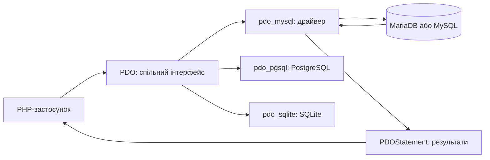
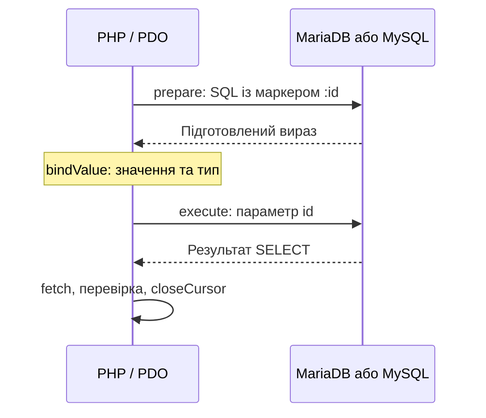

# Лекція 9. Альтернативні засоби під'єднання до СУБД MySQL

[Перелік лекцій](../README.md)

## Мета лекції

Навчитися підключати PHP до БД через PDO, виконувати CRUD і обробляти помилки. Розуміти роль драйверів та межі переносимості SQL.

Середовище — **PHP 8.1, OSPanel 6+**, альтернатива — XAMPP із PHP 8.1; див. [пам’ятку](../../ENVIRONMENT.md). Працюємо на чистому PHP з драйвером `pdo_mysql`. Хост, порт і версію сервера визначають за налаштуваннями вибраного модуля.

## 1. Вступ до PDO: що це і для чого потрібно

PDO (PHP Data Objects) — спільний об’єктний інтерфейс для **різних СУБД**, зокрема PostgreSQL, SQLite, Microsoft SQL Server, Oracle, MySQL та MariaDB. Для кожної потрібен відповідний установлений драйвер. У цій лекції приклади зосереджено на MariaDB і MySQL: драйвер `pdo_mysql`, DSN `mysql:`.



PDO **не перекладає SQL автоматично**. Міграція між СУБД потребує перевірки DSN, типів, функцій SQL і транзакцій. MariaDB і MySQL також мають відмінності між версіями.

Захист від SQL-ін’єкцій забезпечує відокремлення SQL від параметрів, а не сама наявність PDO.

## 2. Встановлення та налаштування PDO

### Перевірка наявності

Перевірте `php -v`, `php --ini`, `php -m` у консолі проєкту та доступність драйвера:

```php
var_dump(extension_loaded('pdo_mysql'));
print_r(PDO::getAvailableDrivers());
```

Для цих прикладів очікуємо true і драйвер mysql. Вебпроцес перевірте через тимчасовий phpinfo(). Конфігурації CLI та вебсервера можуть відрізнятися.

### Увімкнення драйвера

В OSPanel увімкніть `pdo_mysql` для PHP 8.1. У XAMPP за наявності DLL розкоментуйте `extension=pdo_mysql` у завантаженому php.ini й перезапустіть PHP. У Linux пакет залежить від дистрибутива й версії PHP.

## 3. Підключення до MariaDB та MySQL

DSN (Data Source Name) описує драйвер, хост, порт, базу й кодування; ім’я користувача та пароль передають окремо. Реквізити не беруть із HTTP-параметрів.

```php
$dsn = sprintf('mysql:host=%s;port=%d;dbname=%s;charset=utf8mb4',
    $host, $port, $database);
$pdo = new PDO($dsn, $user, $password, [
    PDO::ATTR_ERRMODE => PDO::ERRMODE_EXCEPTION,
    PDO::ATTR_DEFAULT_FETCH_MODE => PDO::FETCH_ASSOC,
    PDO::ATTR_EMULATE_PREPARES => false,
]);
```

Змінні тут уже перевірено. [connection.php](src/connection.php) читає `DB_HOST`, `DB_PORT`, `DB_NAME`, `DB_USER`, `DB_PASSWORD` зі середовища PHP й перевіряє порт. Не припускайте порт 3306 чи порожній пароль.

`ERRMODE_EXCEPTION` задає винятки; `FETCH_ASSOC` — ключі за назвами стовпців; `EMULATE_PREPARES = false` — серверну підготовку. `charset=utf8mb4` налаштовує з’єднання; кодування таблиці задають окремо.

Створіть таблицю у власній навчальній базі; [schema.sql](src/schema.sql) додає два вигадані записи.

```sql
CREATE TABLE users (
    id INT UNSIGNED AUTO_INCREMENT PRIMARY KEY,
    name VARCHAR(80) NOT NULL,
    email VARCHAR(254) NOT NULL,
    UNIQUE KEY uq_users_email (email)
) ENGINE=InnoDB DEFAULT CHARSET=utf8mb4 COLLATE=utf8mb4_unicode_ci;
```

## 4. Виконання SELECT, INSERT, UPDATE, DELETE

Фрагменти нижче виконують після підключення всередині try/catch; це не готовий HTTP-обробник.

### SELECT: запит і читання результату

Сталий SQL без зовнішніх значень можна виконати через query():

```php
$stmt = $pdo->query('SELECT id, name, email FROM users ORDER BY id');
while ($row = $stmt->fetch()) {
    echo '<p>' . htmlspecialchars($row['name'], ENT_QUOTES | ENT_SUBSTITUTE, 'UTF-8') . '</p>';
}
$stmt->closeCursor();
```

query() повертає PDOStatement; fetch() читає рядок або повертає false. fetchAll() збирає весь результат у пам’яті. Кількість записів отримують через `SELECT COUNT(*)` і fetchColumn(): rowCount() для SELECT не є переносимим лічильником.

### Підготовлений пошук за id

Спочатку перевіряють вхідний тип і додатне ціле значення. Тип параметра не замінює валідації:

```php
$rawId = $_GET['id'] ?? null;
$id = is_string($rawId)
    ? filter_var($rawId, FILTER_VALIDATE_INT, ['options' => ['min_range' => 1]])
    : false;
if ($id === false) {
    throw new InvalidArgumentException('Некоректний id.');
}
$stmt = $pdo->prepare('SELECT id, name, email FROM users WHERE id = :id');
$stmt->bindValue(':id', $id, PDO::PARAM_INT);
$stmt->execute();
$user = $stmt->fetch(); // false означає, що користувача не знайдено.
$stmt->closeCursor();
```



Не змішуйте `:name` і `?` в одному запиті. За серверної підготовки кожне входження іменованого параметра має окреме ім’я. Маркер позначає значення; назви таблиць, стовпців і сортування обирають із фіксованого переліку в коді.

### INSERT: додавання

Перевірте рядкові типи, ім’я після trim() від 1 до 80 символів та пошту до 254 байтів через FILTER_VALIDATE_EMAIL. Унікальність email забезпечує індекс БД. Далі `$name` і `$email` уже перевірено.

```php
$stmt = $pdo->prepare('INSERT INTO users (name, email) VALUES (:name, :email)');
$stmt->execute(['name' => $name, 'email' => $email]);
$newId = (int) $pdo->lastInsertId();
$stmt->closeCursor();
```

execute() приймає рядкові значення масивом. bindValue() задає значення й тип, bindParam() — посилання на змінну. lastInsertId() повертає рядок; тут його перетворено на INT у 64-бітному середовищі.

### UPDATE: зміна за первинним ключем

Оновлюйте за унікальним id, а не за ім’ям, яке може повторюватися:

```php
$stmt = $pdo->prepare('UPDATE users SET email = :email WHERE id = :id');
$stmt->bindValue(':email', $newEmail, PDO::PARAM_STR);
$stmt->bindValue(':id', $newId, PDO::PARAM_INT);
$stmt->execute();
$changed = $stmt->rowCount();
$stmt->closeCursor();
```

Нуль змін може означати відсутній запис або те саме значення email. Уточніть результат повторним SELECT: успіх execute() не доводить зміни даних.

### DELETE: видалення конкретного запису

```php
$stmt = $pdo->prepare('DELETE FROM users WHERE id = :id');
$stmt->bindValue(':id', $newId, PDO::PARAM_INT);
$stmt->execute();
$deleted = $stmt->rowCount();
$stmt->closeCursor();
```

UPDATE/DELETE без WHERE можуть змінити або видалити всі рядки. У вебзастосунку зміни виконують через POST після перевірки доступу й CSRF-токена для cookie-автентифікації.

## 5. Обробка помилок і безпека

Підключення й запити охоплюйте try/catch для PDOException. Користувачу — нейтральне повідомлення й HTTP-статус, у журнал — контекст і SQLSTATE без секретів. Не показуйте getMessage() у браузері.

Для InnoDB beginTransaction() починає транзакцію, commit() підтверджує, rollBack() скасовує. Перед відкочуванням перевіряйте inTransaction(). DDL може спричинити неявний commit; AUTO_INCREMENT після rollback може мати пропуски.

[demo.php](src/demo.php) перевіряє CRUD у транзакції з відкочуванням. Підготуйте schema.sql і змінні середовища, виконайте `php demo.php`: початкові записи залишаться. Звільняйте PDOStatement, потім з’єднання присвоєнням null; методу close() у PDO немає.

Параметризація SQL, валідація, HTML-екранування та CSRF-захист виконують різні завдання; PDO не робить їх замість розробника.

## Контрольні питання

1. Які СУБД підтримує PDO й навіщо потрібні окремі драйвери?
2. Чому PDO не гарантує переносимості SQL без змін?
3. Які частини DSN потрібні для MariaDB та MySQL?
4. Для чого задано три атрибути підключення у прикладі?
5. Чим відрізняються query(), prepare(), execute() і fetch()?
6. Що перевіряють до bindValue() та чим він відрізняється від bindParam()?
7. Коли потрібні commit(), rollBack() й inTransaction()?
8. Чому підготовлені запити не замінюють XSS- і CSRF-захист?

## Джерела

1. PHP Documentation Group. [MySQL PDO Driver](https://www.php.net/manual/en/ref.pdo-mysql.php).
2. PHP Documentation Group. [PDO_MYSQL DSN](https://www.php.net/manual/en/ref.pdo-mysql.connection.php).
3. PHP Documentation Group. [PDO::getAvailableDrivers](https://www.php.net/manual/en/pdo.getavailabledrivers.php).
4. PHP Documentation Group. [PDO::prepare](https://www.php.net/manual/en/pdo.prepare.php).
5. PHP Documentation Group. [PDOStatement::execute](https://www.php.net/manual/en/pdostatement.execute.php).
6. PHP Documentation Group. [PDOStatement::bindValue](https://www.php.net/manual/en/pdostatement.bindvalue.php).
7. PHP Documentation Group. [PDOStatement::rowCount](https://www.php.net/manual/en/pdostatement.rowcount.php).
8. PHP Documentation Group. [Errors and error handling](https://www.php.net/manual/en/pdo.error-handling.php).
9. PHP Documentation Group. [Transactions and auto-commit](https://www.php.net/manual/en/pdo.transactions.php).
10. MariaDB. [CREATE TABLE](https://mariadb.com/docs/server/reference/sql-statements/data-definition/create/create-table).
11. PHP Documentation Group. [PDO Drivers](https://www.php.net/manual/en/pdo.drivers.php).
